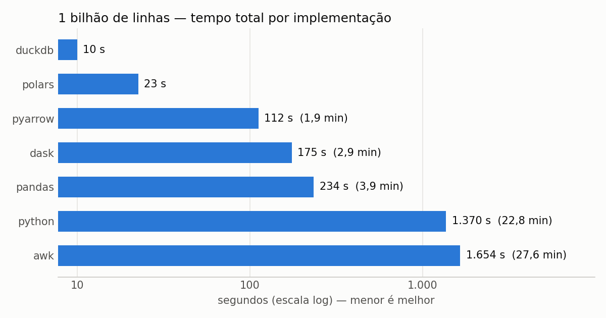

# Um Bilhão de Linhas: Desafio de Processamento de Dados com Python

## Introdução

O objetivo deste projeto é demonstrar como processar eficientemente um arquivo de dados massivo contendo 1 bilhão de linhas (~14GB), especificamente para calcular estatísticas (Incluindo agregação e ordenação que são operações pesadas) utilizando Python. 

Este desafio foi inspirado no [The One Billion Row Challenge](https://github.com/gunnarmorling/1brc), originalmente proposto para Java.

O arquivo de dados consiste em medições de temperatura de várias estações meteorológicas. Cada registro segue o formato `<string: nome da estação>;<double: medição>`, com a temperatura sendo apresentada com precisão de uma casa decimal.

Aqui estão dez linhas de exemplo do arquivo:

```
Hamburg;12.0
Bulawayo;8.9
Palembang;38.8
St. Johns;15.2
Cracow;12.6
Bridgetown;26.9
Istanbul;6.2
Roseau;34.4
Conakry;31.2
Istanbul;23.0
```

O desafio é desenvolver um programa Python capaz de ler esse arquivo e calcular a temperatura mínima, média (arredondada para uma casa decimal) e máxima para cada estação, exibindo os resultados em uma tabela ordenada por nome da estação.

| station      | min_temperature | mean_temperature | max_temperature |
|--------------|-----------------|------------------|-----------------|
| Abha         | -31.1           | 18.0             | 66.5            |
| Abidjan      | -25.9           | 26.0             | 74.6            |
| Abéché       | -19.8           | 29.4             | 79.9            |
| Accra        | -24.8           | 26.4             | 76.3            |
| Addis Ababa  | -31.8           | 16.0             | 63.9            |
| Adelaide     | -31.8           | 17.3             | 71.5            |
| Aden         | -19.6           | 29.1             | 78.3            |
| Ahvaz        | -24.0           | 25.4             | 72.6            |
| Albuquerque  | -35.0           | 14.0             | 61.9            |
| Alexandra    | -40.1           | 11.0             | 67.9            |
| ...          | ...             | ...              | ...             |
| Yangon       | -23.6           | 27.5             | 77.3            |
| Yaoundé      | -26.2           | 23.8             | 73.4            |
| Yellowknife  | -53.4           | -4.3             | 46.7            |
| Yerevan      | -38.6           | 12.4             | 62.8            |
| Yinchuan     | -45.2           | 9.0              | 56.9            |
| Zagreb       | -39.2           | 10.7             | 58.1            |
| Zanzibar City| -26.5           | 26.0             | 75.2            |
| Zürich       | -42.0           | 9.3              | 63.6            |
| Ürümqi       | -42.1           | 7.4              | 56.7            |
| İzmir        | -34.4           | 17.9             | 67.9            |

## Dependências

Para executar os scripts deste projeto, você precisará das seguintes bibliotecas:

* Polars: `0.20.3`
* DuckDB: `0.10.0`
* Dask[complete]: `^2024.2.0`
* PyArrow: `15.0.0`

## Resultados

Testes rodados em um desktop com **AMD Ryzen 7 7800X3D (8 núcleos / 16 threads), 31 GB de RAM, Windows 11**, Python 3.12.1. O tempo é o *wall clock* total de cada script (inclui subir o interpretador e importar a biblioteca), medido por `src/benchmark.py`. Os arquivos de 1M e 10M são as primeiras linhas do arquivo de 1 bilhão.



| Implementação | 1 milhão | 10 milhões | 1 bilhão | Linhas/s (1 bi) |
| --- | ---: | ---: | ---: | ---: |
| DuckDB | 0,17 s | 0,35 s | **10,0 s** | 100,0 mi |
| Polars | 0,29 s | 0,67 s | 22,6 s | 44,3 mi |
| PyArrow | 0,66 s | 1,67 s | 112,3 s | 8,9 mi |
| Dask | 1,11 s | 2,76 s | 175,0 s | 5,7 mi |
| Pandas (multiprocessing) | 1,65 s | 3,90 s | 234,4 s | 4,3 mi |
| Python puro | 1,60 s | 14,71 s | 1.369,6 s (22,8 min) | 0,73 mi |
| Bash + awk | 1,91 s | 16,50 s | 1.654,3 s (27,6 min) | 0,60 mi |

Os dados brutos ficam em [`results.csv`](results.csv). Com 1 milhão de linhas o tempo é dominado pela inicialização do Python e das bibliotecas; a diferença real entre as ferramentas aparece a partir de 10 milhões.

### Resultados originais do projeto

Os testes originais foram realizados em um laptop equipado com um processador M1 da Apple e 8GB de RAM. Os resultados de tempo de execução para processar o arquivo de 1 bilhão de linhas são apresentados abaixo:

| Implementação | Tempo |
| --- | --- |
| Bash + awk | 25 minutos |
| Python | 20 minutos |
| Python + Pandas | 263 sec |
| Python + Dask | 155.62 sec  |
| Python + Polars | 33.86 sec |
| Python + Duckdb | 14.98 sec |

Obrigado por [Koen Vossen](https://github.com/koenvo) pela implementação em Polars e [Arthur Julião](https://github.com/ArthurJ) pela implementação em Python e Bash 

## Conclusão

Este desafio destacou claramente a eficácia de diversas bibliotecas Python na manipulação de grandes volumes de dados. Métodos tradicionais como Bash (25 minutos), Python puro (20 minutos) e até mesmo o Pandas (5 minutos) demandaram uma série de táticas para implementar o processamento em "lotes", enquanto bibliotecas como Dask, Polars e DuckDB provaram ser excepcionalmente eficazes, requerendo menos linhas de código devido à sua capacidade inerente de distribuir os dados em "lotes em streaming" de maneira mais eficiente. O DuckDB se sobressaiu, alcançando o menor tempo de execução graças à sua estratégia de execução e processamento de dados.

Esses resultados enfatizam a importância de selecionar a ferramenta adequada para análise de dados em larga escala, demonstrando que Python, com as bibliotecas certas, é uma escolha poderosa para enfrentar desafios de big data.

Duckdb vence tambem com 1 milhao de linhas, realmente é o melhor

## Como Executar

Para executar este projeto e reproduzir os resultados:

1. Clone esse repositório
2. Definir a versao do Python usando o `pyenv local 3.12.1`
2. `poetry env use 3.12.1`, `poetry install --no-root` e `poetry lock`
3. Execute o comando `python src/create_measurements.py` para gerar o arquivo de teste
4. Tenha paciência e vá fazer um café, vai demorar uns 10 minutos para gerar o arquivo
5. Certifique-se de instalar as versões especificadas das bibliotecas Dask, Polars e DuckDB
6. Execute os scripts `python src/using_python.py`, `python src/using_pandas.py`, `python src/using_dask.py`, `python src/using_polars.py`, `python src/using_pyarrow.py` e `python src/using_duckdb.py` através de um terminal ou ambiente de desenvolvimento que suporte Python. Todos aceitam o caminho do arquivo como argumento (padrão: `data/measurements.txt`).
7. Para comparar todas as implementações de uma vez:

    ```bash
    head -n 1000000 data/measurements.txt > data/measurements_1m.txt    # arquivos menores para testes rápidos
    head -n 10000000 data/measurements.txt > data/measurements_10m.txt
    python src/benchmark.py data/measurements_1m.txt                   # todas as implementações
    python src/benchmark.py data/measurements.txt duckdb polars        # só algumas
    python src/plot_results.py                                         # gera benchmark_1b.png a partir de results.csv
    ```

    Cada execução acrescenta os resultados em `results.csv`.

Este projeto destaca a versatilidade do ecossistema Python para tarefas de processamento de dados, oferecendo valiosas lições sobre escolha de ferramentas para análises em grande escala.

## Bonus

Para rodar o script Bash descrito, você precisa seguir alguns passos simples. Primeiro, assegure-se de que você tenha um ambiente Unix-like, como Linux ou macOS, que suporta scripts Bash nativamente. Além disso, verifique se as ferramentas utilizadas no script (`wc`, `head`, `pv`, `awk`, e `sort`) estão instaladas em seu sistema. A maioria dessas ferramentas vem pré-instalada em sistemas Unix-like, mas `pv` (Pipe Viewer) pode precisar ser instalado manualmente.

### Instalando o Pipe Viewer (pv)

Se você não tem o `pv` instalado, pode facilmente instalá-lo usando o gerenciador de pacotes do seu sistema. Por exemplo:

* No Ubuntu/Debian:
    
    ```bash
    sudo apt-get update
    sudo apt-get install pv
    ```
    
* No macOS (usando [Homebrew](https://brew.sh/)):
    
    ```bash
    brew install pv
    ```
    
### Preparando o Script

1. Dê permissão de execução para o arquivo script. Abra um terminal e execute:
    
    ```bash
    chmod +x process_measurements.sh
    ```

2. Rode o script. Abra um terminal e execute:
   
   ```bash
   ./src/using_bash_and_awk.sh data/measurements_1m.txt
   ```

O argumento é o arquivo a processar (padrão: `data/measurements.txt`). O `pv` é opcional: se não estiver instalado (ex.: Git Bash no Windows), o script roda sem barra de progresso.

Ao executar o script, você verá a barra de progresso (se pv estiver instalado corretamente) e, eventualmente, a saída esperada no terminal ou em um arquivo de saída, se você decidir modificar o script para direcionar a saída.

## Próximos passos

Esse projeto faz parte da *Jornada de Dados*
Nossa missão é fornecer o melhor ensino em engenharia de dados

Se você quer:

- Aprender sobre Duckdb e engenharia de dados
- Construir uma base sólida em Python e SQL
- Criar ou melhorar seu portfólio de dados
- Criar ou aumentar o seu networking na área
- Mudar ou dar o próximo passo em sua carreira

A Jornada de Dados é o seu lugar

[](https://www.jornadadedados2024.com.br/workshops)

Para entrar na lista de espera clique no botao

[](https://forms.gle/hJMtRDP3MPBUGvwS7?orbt_src=orbt-vst-1RWyYmpICDu9gPknLgaD)